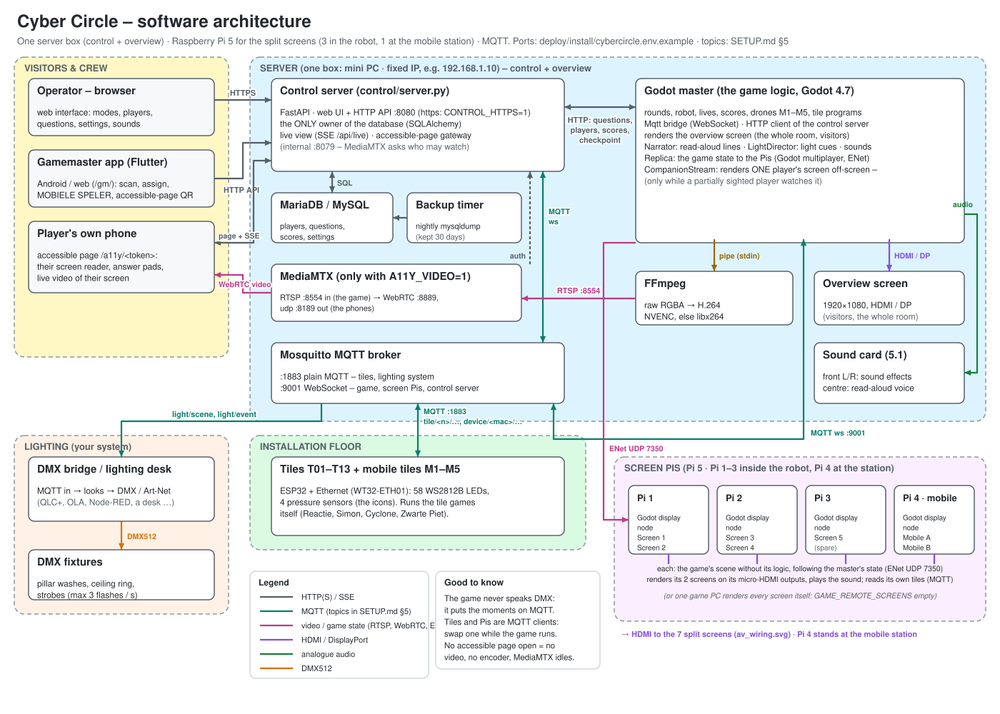
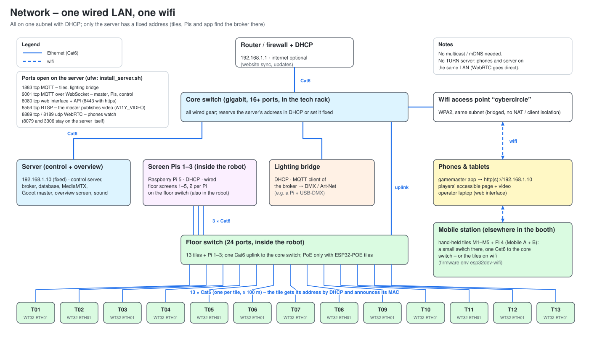
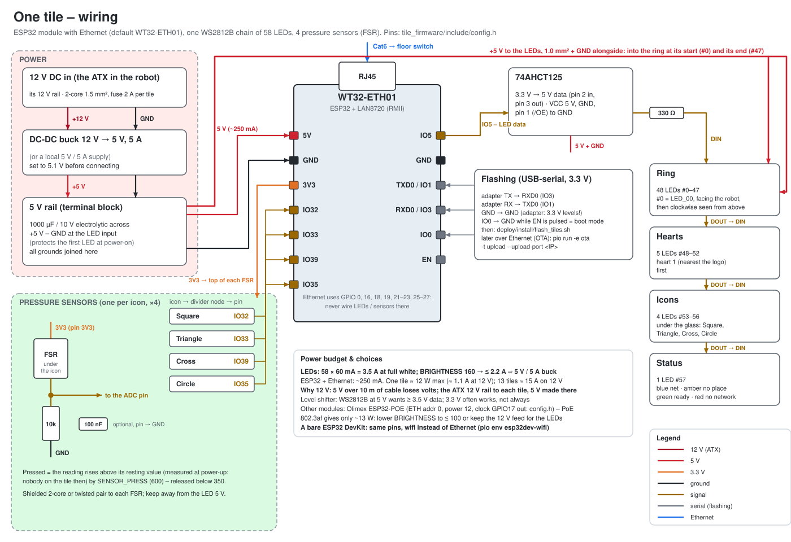
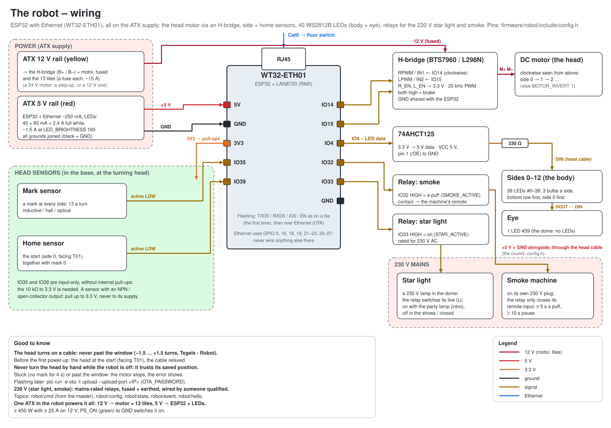
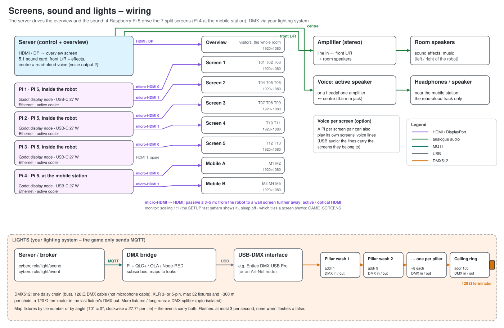
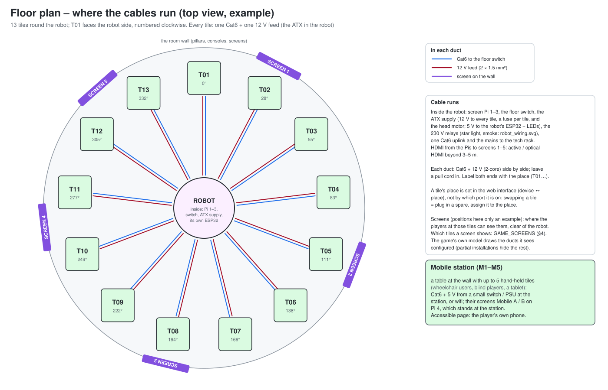
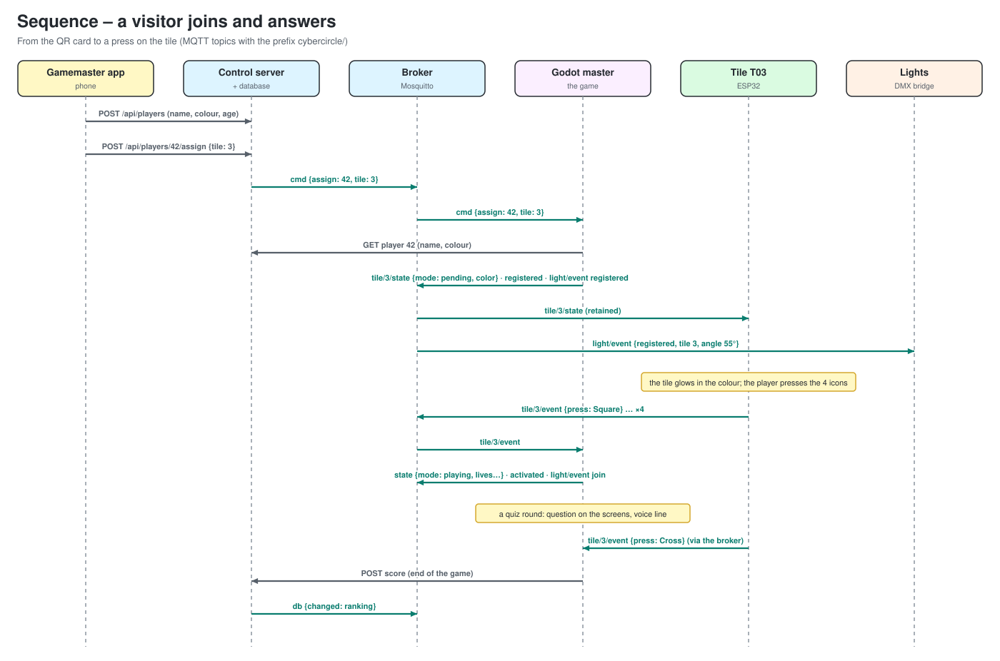
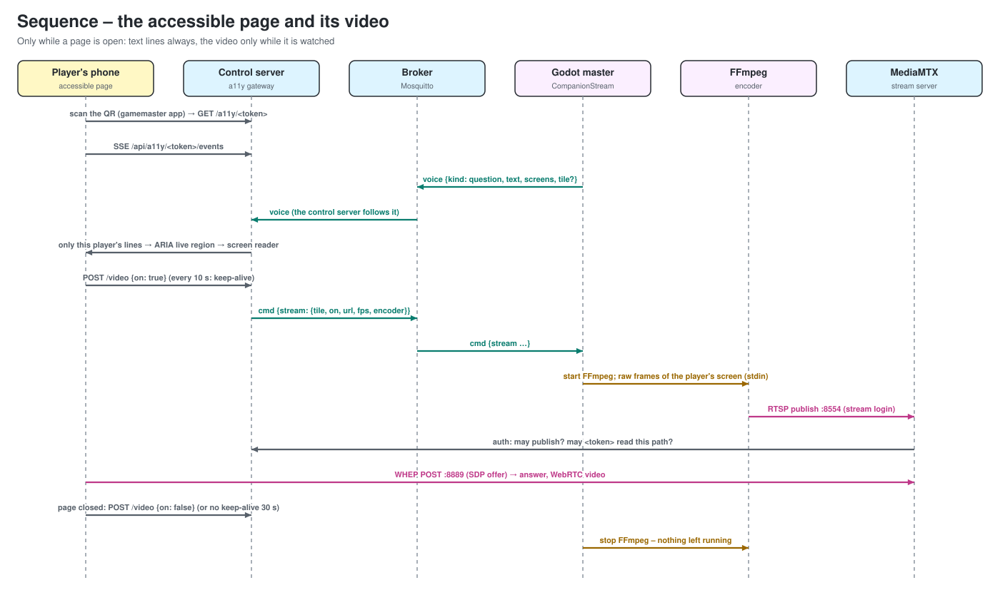
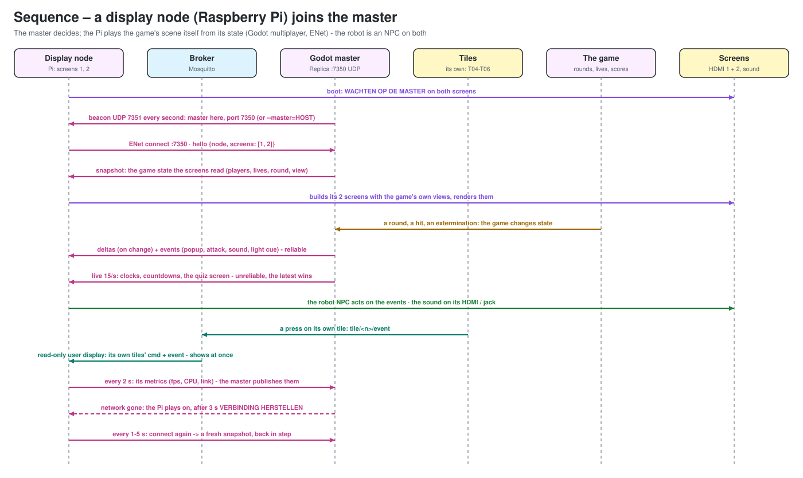

# Cyber Circle – architecture and wiring diagrams

The pictures for building the installation. Details, commands and settings
are in [SETUP.md](SETUP.md). The diagrams are generated by
`python3 tools/make_diagrams.py` (plain SVG in `docs/diagrams/`). To change a
diagram, edit the script and run it again. Pins, ports and topics follow
`tile_firmware/include/config.h`, `deploy/install/cybercircle.env.example` and
SETUP.md §5 (the robot: `robot_firmware/include/config.h`). Keep the script in step with them.

| | diagram | for |
|---|---|---|
| 1 | [Software architecture](#1-software-architecture) | who talks to whom, over what |
| 2 | [Network](#2-network) | switches, wifi, addresses, ports |
| 3 | [One tile](#3-one-tile--wiring) | ESP32, LEDs, pressure sensors, power, flashing |
| 3b | [The robot](#3b-the-robot--wiring-robot_firmware) | ESP32, head motor, side / home sensors, LEDs, smoke |
| 4 | [Screens, sound and lights](#4-screens-sound-and-lights) | monitors, sound on the Pis, DMX chain |
| 5 | [Floor plan](#5-floor-plan--cable-runs) | cable ducts, floor box, screens, mobile station |
| 6 | [Sequences](#6-sequences) | a visitor joining, the accessible page with video, a display node joining |

## 1. Software architecture

* The **control server** is the only process that touches the database.
  The game, the app and the web interface go through its HTTP API.
* Everything live goes over the **MQTT broker**. Tiles and the lighting
  system use plain MQTT (1883), and so does the robot's ESP32: it follows the
  robot NPC's events on `robot/cmd` (SETUP.md §4 *The real robot*). The game
  and the control server use WebSocket (9001).
* **MediaMTX** and the video path only exist with `A11Y_VIDEO=1`, and only
  run while a player watches (SETUP.md §14). The master renders that
  player's screen off-screen and encodes it on the server, so a screen Pi
  never encodes.

**Target hardware: one server box + a Pi per 2 screens.**

| box | runs | drives |
|---|---|---|
| **Server** (one mini PC, fixed IP) | control server, MariaDB, Mosquitto, MediaMTX, the Godot **master** (game logic, overview render) | the overview screen (its sound card only as the fallback, §4) |
| **Screen Pi 1–4** (Raspberry Pi 5, 4 GB): **Pi 1–3 inside the robot**, Pi 4 at the mobile station | a Godot **display node** (`arena.tscn --replica`): follows the master's game state over Godot's multiplayer (ENet, UDP 7350), renders the split views of its 2 screens, plays the sound; reads its own tiles on MQTT | up to 2 screens each over micro-HDMI: Pi 1 = screens 1+2, Pi 2 = 3+4, Pi 3 = 5 (second output spare), **Pi 4 = Mobile A + B, at the mobile station** (elsewhere in the booth) |

**How a display node works** (SETUP.md §4 *Display nodes*): the master runs the
game; each Pi runs the same scene without the game logic and follows the
master over Godot's high-level multiplayer (ENet over UDP 7350): a snapshot of
the game state when it connects, then the changes and the game's events
(popups, attacks, sounds, light cues). It renders its 2 screens and plays the
sound on its own HDMI / audio jack. The robot is an NPC that acts on the
game's events on every node by itself. A Pi may read its own tiles on MQTT
(a read-only user): they are its controllers. If the network goes, the Pis
play on and catch up on return; one PC with GPUs can still take the Pis'
place (`GAME_REMOTE_SCREENS=` empty, the same HDMI runs).

**Server sizing** (rendering the overview, plus a companion video now and
then): a mini PC with an x86 CPU of 6+ cores and 16 GB of RAM, with a GPU that
renders the room at 1080p. An NVIDIA GPU gives NVENC for the video; without
one, libx264 needs about one core per stream. **Per Pi**: a Raspberry Pi 5
(4 GB) with the active cooler, the official 27 W USB-C supply, an NVMe or USB
SSD (or an A2 microSD), wired Ethernet, and 2 micro-HDMI → HDMI cables.

## 2. Network

* One subnet with DHCP. Only the server has a fixed address
  (`SERVER_IP`); the tiles are built with it (`flash_tiles.sh`).
* The wifi must be **bridged** into the same subnet, with no client
  isolation. The phones reach the server directly, and WebRTC needs no TURN
  server.
* The screen Pis are wired (no wifi), and get their address by DHCP. Pi 1–3
  sit on the floor switch inside the robot; Pi 4 sits on the mobile
  station's own small switch. The robot's ESP32 is on the floor switch too.
* Tiles announce their MAC address. Which place a tile stands on is set in
  the web interface, not by the switch port.

## 3. One tile – wiring

**Pin table** (WT32-ETH01, firmware defaults):

| what | pin | note |
|---|---|---|
| LED data (WS2812B chain) | **IO5** | through a 74AHCT125 (3.3 → 5 V) and 330 Ω into DIN of ring LED #0 |
| Square sensor | **IO32** | FSR from 3V3, 10 kΩ to GND, node to the pin |
| Triangle sensor | **IO33** | same |
| Cross sensor | **IO39** | same (input only, ADC1) |
| Circle sensor | **IO35** | same (input only, ADC1) |
| Ethernet (LAN8720) | 0, 16, 18, 19, 21–23, 25–27 | taken by the module: wire nothing else there |
| Flashing | TXD0/IO1, RXD0/IO3, IO0, EN | 3.3 V USB-serial adapter; IO0 to GND during reset = boot mode |
| 5 V, GND | 5V, GND | from the tile's 5 V rail |

**The LED chain** (one data line, 58 LEDs, in this order): ring 48
(#0–47, #0 = LED_00 facing the robot, then clockwise seen from above) →
hearts 5 (#48–52, heart 1 nearest the logo) → icon LEDs 4 (#53–56: Square,
Triangle, Cross, Circle) → status LED (#57). Wired in another order? Change
`RING_FIRST`, `HEART_FIRST`, `ICON_FIRST` and `STATUS_LED` in `config.h`.

**Power per tile**: LEDs ≤ 2.2 A at `BRIGHTNESS 160` (3.5 A at full white),
plus about 250 mA for the ESP32 and the PHY. That calls for a 5 V / 5 A buck
converter at the tile, fed with 12 V from the **ATX supply in the robot** (its
12 V rail, 2 × 1.5 mm², 2 A fuse per tile: about 1.1 A per tile, 15 A for
all 13 on 12 V; 5 V straight over the ducts would lose too much). Feed 5 V
into the ring at both ends (#0 and #47), and put 1000 µF across the LED input.
All grounds are joined at the tile's terminal block.

**Parts list per tile**:

| part | quantity |
|---|---|
| WT32-ETH01 (or Olimex ESP32-POE, then set `TILE_ETH_*` in config.h) | 1 |
| WS2812B LEDs: a 48-LED ring, 5 heart LEDs, 4 icon LEDs, 1 status LED (or strip pieces) | 58 |
| FSR pressure sensor (e.g. FSR 406 / 402 under each icon) | 4 |
| resistor 10 kΩ (divider) / 330 Ω (LED data) | 4 / 1 |
| 100 nF ceramic (optional, sensor pin → GND) | 4 |
| 74AHCT125 (or 74HCT245 / SN74AHCT1G125) | 1 |
| electrolytic capacitor 1000 µF / 10 V | 1 |
| DC-DC buck 12 V → 5 V, 5 A | 1 |
| fuse holder + 2 A fuse, terminal block, RJ45 keystone / pass-through | 1 each |

**Sensor pins (changed).** The Cross sensor used to be on GPIO34. The
WT32-ETH01 does not break out GPIO34, and on the Olimex ESP32-POE it is the
on-board button. It is now on **GPIO39**, which every one of these boards has
as an ADC1 input (`SENSOR_PINS` in `config.h`, and the Wokwi `diagram.json`).

## 3b. The robot – wiring (robot_firmware/)

The robot is an ESP32 (WT32-ETH01, Ethernet) like the tiles. The head turns on
a **DC motor** through an **H-bridge**; a **mark sensor** sees a mark at every
side (13 per turn), a **home sensor** the start position (side 0, facing T01);
FastLED drives the bulbs of the body and the eye (the dome has no LEDs). Two
**relays** switch the 230 V loads: the **star light** (a 230 V lamp in the dome,
on with the party lamp: the intro, `{"party": true}`; off during the boot /
shutdown shows and when the game is closed) and the **smoke machine** (on its
own 230 V plug; the relay closes its remote input). Use mains-rated relays,
fused and earthed, wired by someone qualified, and keep the 230 V away from
the 5 V and signal wiring.

**Power**: everything comes from the **ATX supply** in the robot, which also
feeds the tiles. The 12 V rail (yellow, fused) feeds the H-bridge and the
motor, and the 13 tiles (~15 A): pick ≥ 450 W with ≥ 25 A on 12 V. An ATX
supply has no 24 V: a 24 V motor needs a step-up converter (or use a 12 V
motor). The 5 V rail (red) feeds the ESP32 and the LEDs (about 1.5 A at
`LED_BRIGHTNESS 160`, 2.4 A full white). All grounds (black) are joined. The
supply starts when PS_ON (green) is tied to GND (a switch, or a wire link to
always on). A cable runs into the head: the firmware never turns it further than
the window set in the control UI (default −1.5 … +1.5 turns from the start).

**Pin table** (`robot_firmware/include/config.h`, every pin can be changed):

| what | pin | note |
|---|---|---|
| Motor clockwise (BTS7960 RPWM / L298N IN1) | **IO14** | 20 kHz PWM; clockwise seen from above = side 0 → 1 → 2 … (else `MOTOR_INVERT 1`) |
| Motor counter-clockwise (LPWM / IN2) | **IO15** | both high = brake; R_EN / L_EN (BTS7960) to 3.3 V |
| Mark sensor | **IO35** | inductive / hall / optical, active LOW, 10 kΩ pull-up to 3.3 V (input only) |
| Home sensor | **IO39** | active LOW at the start position, together with mark 0 |
| LED data (WS2812B chain) | **IO4** | through a 74AHCT125 (3.3 → 5 V) and 330 Ω |
| Smoke machine relay | **IO32** | relay module / MOSFET on its remote input (active HIGH, `SMOKE_ACTIVE`) |
| Star light relay | **IO33** | mains-rated relay, switches the 230 V lamp's live (active HIGH, `STAR_ACTIVE`) |
| Ethernet (LAN8720) | 0, 16, 18, 19, 21–23, 25–27 | taken by the module |
| Flashing | USB-serial the first time, then over Ethernet (OTA) | `pio run -e ota -t upload --upload-port <IP>` |

**The LED chain** (one data line, in this order): the bulbs of side 0 (3,
bottom row first), side 1, … side 12 (39) → the eye (1): 40 LEDs. The dome
has no LEDs (`DOME_LEDS 0`; a build with LEDs there sets it and they follow
the dome colour and the party lamp).
`BULBS_PER_SIDE`, `DOME_LEDS`, `EYE_LEDS` in `config.h`.

**Before the first power-up**: turn the head by hand to the start position
(facing T01) with the cable relaxed. The robot homes at every boot, starting
from the position it saved when it last stopped; with nothing saved (the very
first boot) it looks for the nearest home within half a turn – the home sensor
fires at every full turn, so it cannot tell +1 turn from the start by itself. For the same
reason: **never turn the head by hand while the robot is off** (or put it back
at the start before powering on) – it trusts the position it saved.

## 4. Screens, sound and lights

* **8 monitors** by default: the overview on the server, and the 7 split
  screens on 4 Pis. Pi 1–3 drive the floor screens. Pi 4 stands at the
  mobile station and drives Mobile A and B. The station is elsewhere in the
  booth: give it a small switch with one Cat6 to the core switch, for Pi 4
  and the hand-held tiles. These are the 5 floor screens (`GAME_SCREENS`)
  and the 2 mobile screens (`GAME_MOBILE_SCREENS`). Fewer screens means
  fewer Pis: 3 tiles per screen is the most the layout allows.
* **Pi 1–3 are mounted inside the robot**, with the floor switch and the
  ATX supply (the tiles and the robot): one mains feed and one Cat6 uplink go into the robot. Give the
  robot ventilation: three Pi 5s at full load are about 30 W, and the
  switch and the ATX supply add more. HDMI to screens 1–5 runs from the robot.
  Passive micro-HDMI → HDMI is fine up to about 3–5 m; further to a wall
  screen, use active or optical HDMI.
* **Audio: on the Pis.** Each Pi plays the sound on its 3.5 mm jack or over
  HDMI (active speakers, or the monitors' own speakers): every sound effect
  (the master picks the file, all Pis play the same) plus the read-aloud
  lines of its own screens (a question on every Pi, an invite only on the Pi
  with that tile's screen). Pi 4 gets a speaker or headphones at the mobile
  station. *Instellingen › Geluid*: automatic = on the Pis when any are
  connected; master / both use the server's sound card instead (5.1: effects
  on front L/R, the voice on its own **centre** jack). The narrator
  (*Instellingen › Voorlezen*) has its own on / off and is off by default.
* **DMX**: the game only publishes `light/scene` and `light/event`. A bridge
  (QLC+, OLA, Node-RED, or a lighting desk with MQTT/OSC input) turns them into
  DMX. Use one daisy chain per universe, 120 Ω DMX cable, and a terminator in
  the last fixture. The DMX addresses shown are an example.

## 5. Floor plan – cable runs

The screen positions are an example: the game does not know where they
hang, only which tiles each screen shows. Put each screen where the players
at its tiles can see it.

## 6. Sequences

